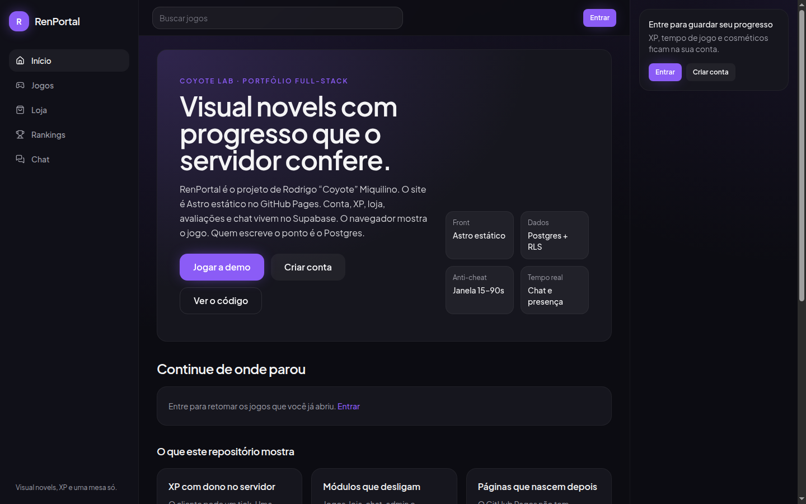
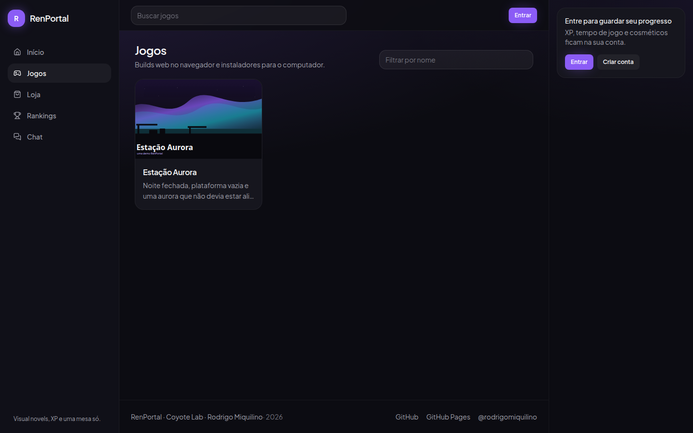
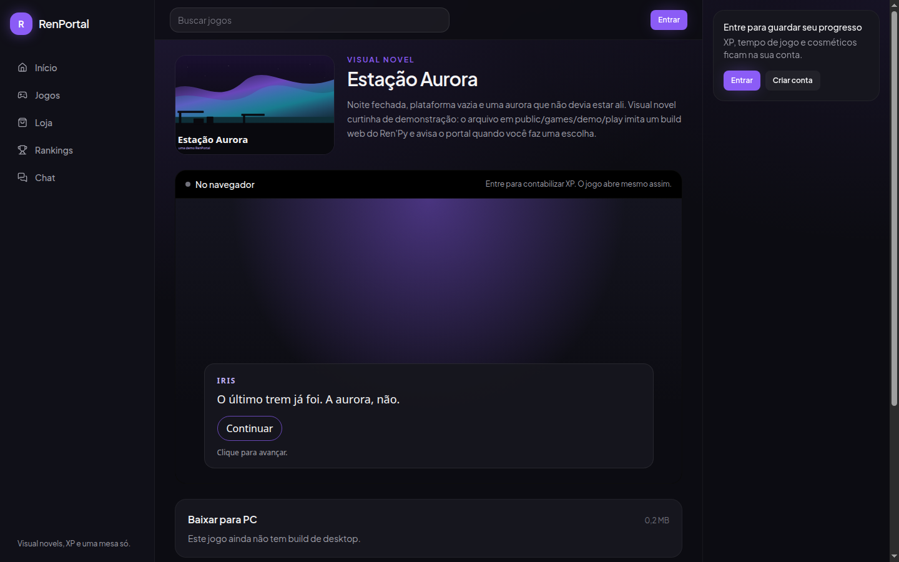
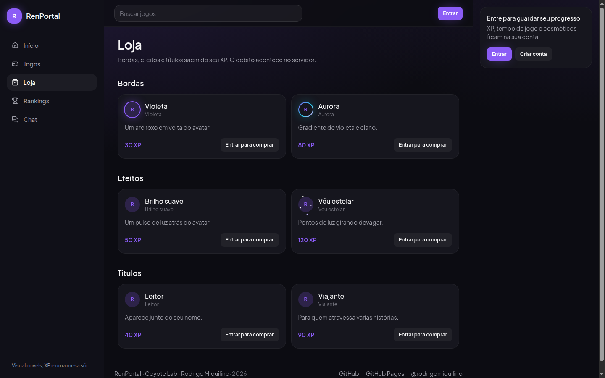
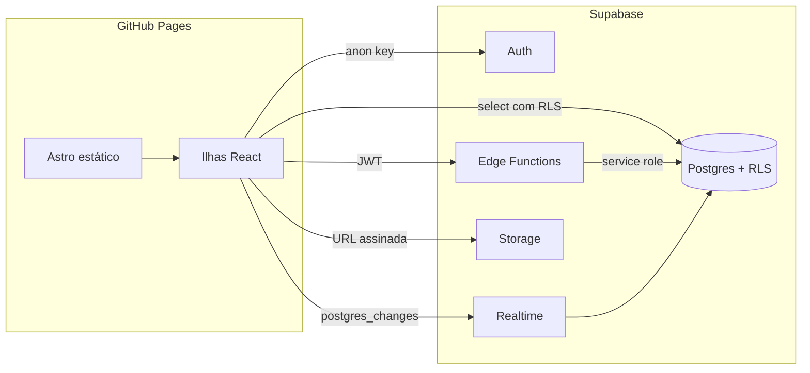

# RenPortal

[](https://astro.build)
[](https://supabase.com)
[](https://www.typescriptlang.org)
[](LICENSE)

Portal de visual novels Ren'Py. O site é estático. O XP não é.

**English.** RenPortal is a portfolio project by Rodrigo “Coyote” Miquilino (Coyote Lab). An Astro static site on GitHub Pages talks to Supabase for auth, Postgres with row level security, Edge Functions, Realtime and Storage. Play time, purchases and XP gifts are server-authoritative: the browser never writes the balance. Live site: [rodrigomiquilino.github.io/renportal](https://rodrigomiquilino.github.io/renportal/).



Projeto Supabase **renportal**, ref `wlacdgwbwsykvpobkbib`. Autor: Rodrigo Miquilino, GitHub [@rodrigomiquilino](https://github.com/rodrigomiquilino).

## Capturas

| Início | Biblioteca | Demo | Loja |
| --- | --- | --- | --- |
| [](docs/screenshots/home.png) | [](docs/screenshots/jogos.png) | [](docs/screenshots/estacao-aurora.png) | [](docs/screenshots/loja.png) |

A página 404 e o login estão em `docs/screenshots/nao-encontrada.png` e `docs/screenshots/entrar.png`.

## O que o projeto demonstra

- Site estático no GitHub Pages, com `base` `/renportal/`, e ilhas React só onde o estado muda.
- Auth, RLS e Storage no Supabase. Toda tabela tem policy. Colunas críticas (`xp`, `level`, `role`, tempo de jogo) não entram no `GRANT` de update do usuário.
- Heartbeat anti-cheat: a função `apply_play_tick` só premia um intervalo de 15 a 90 segundos e recusa tempo que ultrapassa o relógio.
- Compra e doação são transações `security definer`. Duas contas no chat recebem a mensagem pelo Realtime, com presença para quem está digitando.
- Módulos com feature flag de build. Auth não desliga.

Detalhe de fluxo em [docs/ARCHITECTURE.md](docs/ARCHITECTURE.md). Modelo de ameaça em [docs/SECURITY.md](docs/SECURITY.md).

## Arquitetura



O HTML publicado é a casca. XP, catálogo e mensagens são buscados no cliente, então um deploy não congela o placar.

## Heartbeat e anti-cheat

O embed abre `start-session` ao montar. A cada 30 segundos, se `document.visibilityState === 'visible'`, manda um heartbeat. Esconder a aba por ~45 segundos, sair da página ou desmontar o componente chama `end-session`.

`apply_play_tick` é quem conta:

- Só premia se passaram entre 15 e 90 segundos desde o último batimento. Soma `min(elapsed, 90)` em `awarded_seconds` e no tempo total do perfil.
- A cada 60 segundos acumulados, +1 XP com `source = 'play_time'` e `recalculate_level`.
- Menos de 15s num heartbeat, outra sessão ativa, tempo acumulado acima do relógio da partida, ou um buraco maior que 10 minutos: a sessão fica `flagged` e não rende XP.
- Encerrar a sessão (`p_close`) ainda premia um intervalo válido, mas não marca “rápido demais” quando o último pedaço é curto.

Um marco do jogo (`postMessage` com `renportal:milestone`) só aparece na interface. Não dá XP.

Nível: `greatest(1, floor(sqrt(xp / 40)) + 1)`. Quarenta XP separam o nível 1 do 2.

## Segurança em uma página

| Quem | O que pode |
| --- | --- |
| `anon` | Ler jogos publicados e itens ativos da loja. |
| `authenticated` | Ler o próprio extrato, as próprias sessões, mensagens das conversas em que participa. Atualizar nome, avatar e cosmético equipado. |
| `service_role` | Chamar `apply_play_tick`, `purchase_item`, `donate_xp`. A chave fica no ambiente da função. |
| Admin | Policies e RPCs (`set_user_role`, `admin_stats`) conferem `is_admin()`. |

O gateway das Edge Functions usa `verify_jwt = false` para o preflight CORS (`OPTIONS`) não receber 401. Cada função chama `readUser` e só então usa a service role. `donate-xp` está nesse mesmo bloco em `supabase/config.toml`.

Doação: sem auto-presente, entre 10 e 500 XP, teto de 2000 XP por dia no fuso `America/Sao_Paulo`.

## Módulos

Cada pasta em `src/modules/` é independente. Só auth é dependência dos outros. A flag mora em `src/lib/features.ts`. Ausente, vazio ou `true` liga. `false` esconde o menu e a página mostra “Módulo desativado”.

| Módulo | Flag | Como ativar este módulo |
| --- | --- | --- |
| Base, auth e layout | sempre ligado | `001_base.sql`. O cadastro cria o perfil por trigger em `auth.users`. |
| Jogos Ren'Py | `PUBLIC_FEATURE_GAMES` | `002_games.sql` e o seed. Build web em `public/games/<slug>/play/`. |
| Progressão | `PUBLIC_FEATURE_PROGRESSION` | `003_progression.sql` e as functions `start-session`, `heartbeat`, `end-session`. |
| Loja | `PUBLIC_FEATURE_SHOP` | `004_shop.sql`, function `purchase-item` e os itens do seed. |
| Feedback | `PUBLIC_FEATURE_FEEDBACK` | `005_feedback.sql`. Nota geral obrigatória. A média ignora `hidden`. |
| Amigos e chat | `PUBLIC_FEATURE_CHAT` | `006_chat.sql`. Publica `messages` e `friendships` no Realtime. |
| Admin | `PUBLIC_FEATURE_ADMIN` | `007_admin.sql`, function `admin-upload-game` e `role = 'admin'`. |
| Doações de XP | `PUBLIC_FEATURE_DONATIONS` | `008_donations.sql` e a function `donate-xp`. |

O que ainda depende do painel do Supabase (migrations 009 e 010, function de upload, GitHub, Google e URLs de redirect) está em [docs/BACKEND.md](docs/BACKEND.md).

## Como rodar localmente

```bash
cp .env.example .env
npm install
npm run dev -- --host 127.0.0.1 --port 4455
```

Com o `.env.example`, o app abre em `http://127.0.0.1:4455/renportal/`. Para servir na raiz do localhost, use `PUBLIC_BASE_PATH=/`.

- `npm run build` gera `dist/`
- `npm run typecheck` roda `astro check`
- `npm test`, `npm run lint` e `npm run format:check` são o que a CI roda no pull request

A URL e a chave publishable já são o padrão do cliente. O `.env` é opcional se você aceita esses valores.

| Variável | Função |
| --- | --- |
| `PUBLIC_SUPABASE_URL` | `https://wlacdgwbwsykvpobkbib.supabase.co` |
| `PUBLIC_SUPABASE_ANON_KEY` | chave publishable `sb_publishable_NkEk7Pn-moYRffrMVcpWNg_J_AMvcB9` |
| `PUBLIC_BASE_PATH` | `/renportal/` no GitHub Pages. `/` na raiz. |
| `PUBLIC_SITE_URL` | origem canônica, `https://rodrigomiquilino.github.io` |
| `PUBLIC_FEATURE_*` | liga ou desliga um módulo no build |

Não commite senha do banco, service role nem access token. Eles não entram no frontend.

## Supabase

O schema deste projeto **já foi aplicado** no ref `wlacdgwbwsykvpobkbib` pela Management API (migrations `001`–`008` e o seed). As seis functions também já estão publicadas: `start-session`, `heartbeat`, `end-session`, `purchase-item`, `donate-xp`, `admin-upload-game`.

Por isso o histórico do CLI (`supabase_migrations.schema_migrations`) pode não conhecer esses arquivos. Antes de um `supabase db push`, marque as versões como aplicadas. Sem isso o CLI tenta rodar de novo e quebra em objetos que já existem.

```bash
supabase link --project-ref wlacdgwbwsykvpobkbib
for v in 001 002 003 004 005 006 007 008; do
  supabase migration repair --status applied "$v"
done
```

Um banco novo, sem esse histórico, pode receber os arquivos de `supabase/migrations/` na ordem e depois `supabase/seed.sql`.

Promova o primeiro admin no SQL Editor (a sessão `postgres` atravessa a trava de colunas):

```sql
update public.profiles
set role = 'admin'
where username = 'seu_usuario';
```

### Segredos das Edge Functions

O Supabase injeta `SUPABASE_URL`, `SUPABASE_ANON_KEY` e `SUPABASE_SERVICE_ROLE_KEY` nas functions hospedadas. Não grave esses valores no repositório.

Para definir ou girar a service role:

```bash
supabase secrets set SUPABASE_SERVICE_ROLE_KEY="cole-a-service-role-aqui" --project-ref wlacdgwbwsykvpobkbib
supabase functions deploy start-session heartbeat end-session purchase-item donate-xp admin-upload-game --project-ref wlacdgwbwsykvpobkbib
```

## Deploy

O workflow [`.github/workflows/deploy.yml`](.github/workflows/deploy.yml) publica `dist/` no GitHub Pages a cada push na `main`. O passo `actions/configure-pages` usa `enablement: true` para ligar o site na fonte **GitHub Actions**. O `GITHUB_TOKEN` padrão não tem `administration: write`; se a criação do site falhar, o dono liga uma vez em Settings → Pages → Source → GitHub Actions. Os deploys seguintes seguem sozinhos.

O alvo é [https://rodrigomiquilino.github.io/renportal/](https://rodrigomiquilino.github.io/renportal/). O padrão de `PUBLIC_BASE_PATH` é `/renportal/` e o de `PUBLIC_SITE_URL` é `https://rodrigomiquilino.github.io`. Repository variables com o mesmo nome sobrescrevem esses padrões. Se estiverem vazias, o build usa os valores públicos acima.

## Rotas no GitHub Pages

`output: 'static'` e `trailingSlash: 'always'`.

- `/games/<slug>/` e `/profile/<usuario>/` são gerados no build com o que o Supabase devolver (a demo entra sempre).
- `/game/?slug=` e `/profile/?username=` servem um registro que nasceu depois.
- `404.html` redireciona um jogo ou perfil desconhecido para a rota com query string.

## Como adicionar um jogo Ren'Py

O `index.html` do build web **não** pode ficar em `public/games/<slug>/`. Essa URL é a página do portal. Coloque o export em `public/games/<slug>/play/` e grave `web_path` como `/games/<slug>/play/index.html`.

Desktop: no admin, a function `admin-upload-game` devolve uma URL assinada para o bucket `game-builds`. O portal grava o resultado em `windows_url`, `mac_url` ou `linux_url`.

`public/games/demo/play/` imita um build web e manda este aviso. Não é um export real do Ren'Py.

```js
parent.postMessage({ type: 'renportal:milestone', id: 'primeira-escolha', label: 'Primeira escolha' }, '*')
```

## Como testar o heartbeat

1. Confirme que as migrations `001`–`003`, o seed e as functions `start-session`, `heartbeat` e `end-session` estão no projeto.
2. Crie uma conta. Se o Auth exigir confirmação de e-mail, confirme o usuário ou desligue essa opção no painel.
3. Abra **Estação Aurora** logado, com a aba visível.
4. O status vai para “Sessão ativa”. O primeiro heartbeat sai aos 30 segundos.
5. Por volta de 60 segundos contabilizados aparece +1 XP. O cartão da direita atualiza o total.
6. No SQL Editor:

```sql
select xp, level, total_play_time_seconds
from public.profiles
where username = 'seu_usuario';

select amount, source, created_at
from public.xp_log
order by id desc
limit 5;
```

7. O nível 2 pede 40 XP, cerca de 40 minutos. Um minuto já prova o pipeline.
8. Esconda a aba por cerca de um minuto: a sessão encerra e o intervalo válido ainda entra na conta. Voltar abre outra sessão.
9. Duas abas do mesmo jogo: a segunda encerra a primeira. Se as duas ficarem ativas, o heartbeat marca `flagged` e não dá XP.

## Como testar o chat com duas contas

1. Confirme `006_chat.sql` e que `messages` está na publicação Realtime.
2. Crie duas contas, uma em janela anônima.
3. Na conta A, em **Chat**, busque o usuário da conta B e envie o pedido.
4. Na conta B, aceite. As listas atualizam pelo Realtime de `friendships`.
5. Clique em **Conversar**. `create_direct_conversation` abre a sala se o status for `accepted`.
6. Mande uma mensagem. Ela aparece na outra janela, filtrada por `conversation_id`.
7. **Responder** mostra o texto original. **Editar** marca “editada”. **Apagar** vira “Mensagem apagada” (`deleted_at` preenchido, a linha continua).
8. Digite sem enviar: a outra pessoa vê “Digitando…”. O ponto verde usa o canal `renportal:online`.

## Loja, feedback, admin e doações

A compra chama `purchase-item`. Equipar atualiza `active_border`, `active_effect` ou `active_title`. O trigger só aceita a chave se o item estiver no inventário.

O feedback é um upsert da própria linha. A média ignora `hidden`. Só o admin muda `hidden` ou apaga.

O presente de XP fica no perfil de outra pessoa. O botão some no próprio perfil, que lista o que chegou.

## Licença

[MIT](LICENSE). Rodrigo Miquilino, Coyote Lab.
