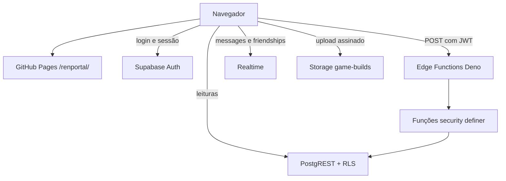
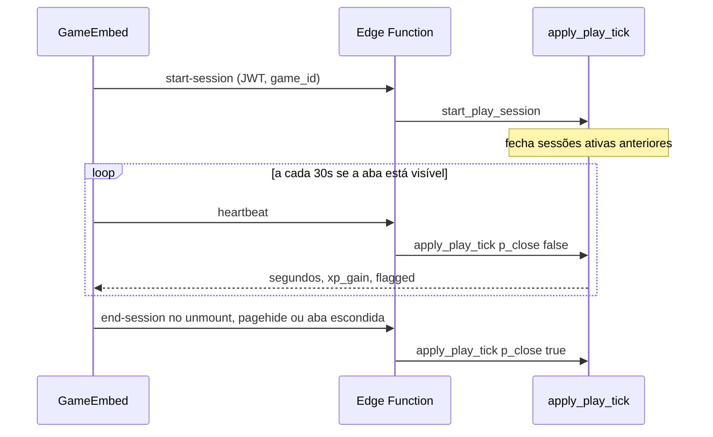

# Arquitetura

RenPortal separa o que pode ser um arquivo estático do que precisa de um dono no servidor.

O Astro gera HTML, CSS e um pouco de JavaScript. O GitHub Pages entrega esses arquivos em `https://rodrigomiquilino.github.io/renportal/`. Não há Node em produção. Ilhas React (`client:load`) cuidam de sessão, catálogo, player, loja, chat e admin. O restante da página, inclusive o título do hero, já vem no HTML.

## Peças

| Pasta | Papel |
| --- | --- |
| `src/pages` | Rotas estáticas. `getStaticPaths` pré-renderiza slugs conhecidos. |
| `src/modules` | Uma fatia de produto por pasta. A flag correspondente está em `src/lib/features.ts`. |
| `src/lib/supabase.ts` | Cliente do browser. Usa a URL pública e a chave publishable. |
| `supabase/migrations` | Schema, RLS, triggers e funções. `001` … `008`. |
| `supabase/functions` | Borda HTTP. Validam o JWT e chamam o SQL. |
| `public/games/<slug>/play` | Build web do Ren'Py. A página do portal ocupa `/games/<slug>/`. |

## Por que o XP não mora no cliente

O navegador é um ambiente hostil para saldo. Qualquer `update` em `profiles.xp` seria um cheat de uma linha. O desenho tem três travas, descritas em [SECURITY.md](SECURITY.md):

1. O `GRANT` de `UPDATE` do papel `authenticated` não inclui `xp`, `level`, `role` nem `total_play_time_seconds`.
2. O trigger `protect_profile_columns` devolve essas colunas se um papel mais largo tentar gravá-las sem a GUC `renportal.trusted_write`.
3. As escritas de verdade passam por funções `security definer` executáveis só pela `service_role`, chamadas pelas Edge Functions.

O nível é `greatest(1, floor(sqrt(xp / 40)) + 1)`, a mesma fórmula no SQL e em `src/lib/level.ts`.

## Sessão de jogo

A janela de 15–90 segundos é o anti-cheat. Um script que dispara heartbeat a cada segundo marca a sessão. Um intervalo de horas também. O tempo premiado não pode ultrapassar o relógio desde o início da partida, com uma folga de 5 segundos.

Ordem de lock: a função trava a linha do perfil e depois a sessão, a mesma ordem do `start`. Doação trava os dois perfis em ordem de UUID para duas pessoas não se presentarem em cruz e ficarem presas.

## Chat

Amizade é uma linha em `friendships` com status `pending`, `accepted` ou `blocked`. Um par não se repete (`least`/`greatest`).

`create_direct_conversation` exige amizade aceita e reaproveita a sala 1:1. Mensagens entram na publicação `supabase_realtime`. O cliente assina `postgres_changes` com filtro `conversation_id`. Presença usa o canal `renportal:online` no layout e um canal da conversa para “digitando”.

Apagar é soft delete (`deleted_at`). A bolha mostra “Mensagem apagada”. Editar preenche `edited_at`.

A policy de mensagem não faz subquery em `conversation_participants` direto, porque a policy de participante olharia de volta para a mensagem. `is_conversation_participant()` é `security definer` e quebra o ciclo.

## Rotas que ainda não existiam no build

GitHub Pages não tem SSR. `getStaticPaths` pergunta os slugs publicados na hora do build e sempre inclui `demo`. Um jogo cadastrado depois cai no `404.html`, que troca `/games/<slug>/` por `/game/?slug=`. O mesmo vale para `/profile/<usuario>/`. Os componentes leem a query string e buscam a linha.

## Feature flags

`PUBLIC_FEATURE_<NOME>` entra no bundle via `import.meta.env`. Mudar a flag pede outro build. Auth não tem flag: login é a base dos outros módulos. Com a flag desligada, o item some do menu e a rota mostra o aviso de módulo desativado, em vez de um pedaço de UI sem backend.

## Onde mexer

| Quero… | Abro |
| --- | --- |
| Uma regra de XP | `supabase/migrations/003_progression.sql` e o embed em `src/modules/games/GameEmbed.tsx` |
| Um cosmético | `004_shop.sql`, `src/modules/shop`, classes em `src/styles/global.css` |
| Uma mensagem | `006_chat.sql` e `src/modules/chat/ChatApp.tsx` |
| O visual do portal | `src/styles/global.css` e `src/layouts` |
| O path do GitHub Pages | `astro.config.mjs` e `.github/workflows/deploy.yml` |
